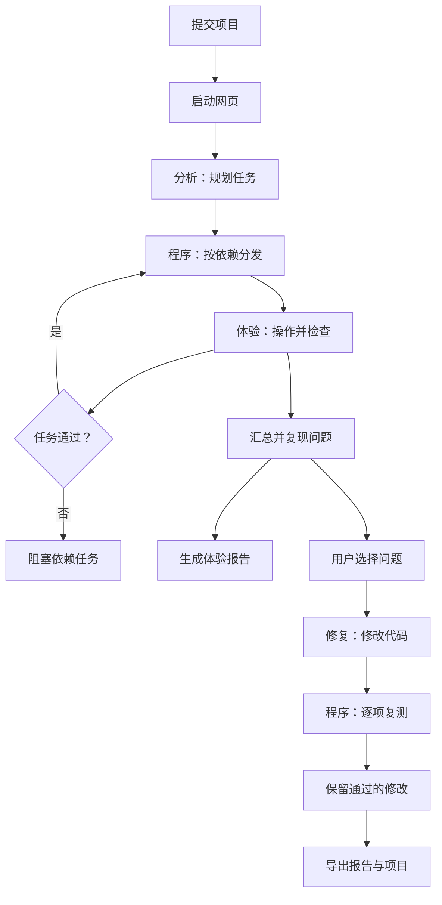

# DemoClinic

**从 Demo 源码 ZIP 到体验报告与可验证的修复，在 Jupyter 中完成。**

DemoClinic 是面向 Web Demo 的 AI 体验与修复工作流。分析 Agent 根据项目资料、首页与部分源码生成分层任务；Python 按依赖调度体验 Agent，在真实浏览器中收集证据。用户查看报告、选择问题编号后，修复 Agent 逐项修改，程序逐项复测。

工作流不绑定任何示例项目，不预置某个 Demo 的功能、选择器或缺陷答案。

[快速开始](#快速开始) · [工作原理](#工作原理) · [使用流程](#使用流程) · [配置](#配置) · [开发与验证](#开发与验证) · [当前边界](#当前边界)

## 核心能力

- **按项目规划测试**：结合用户目标与页面信息选择检查维度，生成带前置依赖的任务卡。
- **分层执行，避免连锁报错**：基础任务失败或未确认通过时，依赖它的任务标记为阻塞；独立任务继续执行。
- **真实浏览器体验**：使用 Playwright 点击、输入、切换页面、检查结果，保留操作记录与截图。
- **短任务与有限记忆**：各任务使用独立上下文，按需读取证据，携带简短页面记忆，减少整段历史反复发送。
- **报告与修复分流**：JSON 保存结构化证据，Python 默认直接生成面向用户的 HTML 报告，无须额外调用模型写 HTML。
- **用户决定修哪些**：按问题编号选择，逐项修复、逐项复测；失败的候选不覆盖已验收的修改。
- **保留原始项目**：在副本中体验和修复，导出报告、原始项目或带明确验证状态的修改 ZIP。

## 工作原理



图中“分析、体验、修复”对应三路独立模型 API；程序负责分发、判断、报告排版与导出。前置失败时只阻塞依赖它的任务，其他独立任务继续执行。


分析 Agent 负责决定“应该测什么”；体验 Agent 负责执行任务并记录证据；修复 Agent 负责修改源码。Python 负责调度、校验、报告排版和文件导出。它们不依赖模型平台自带的“子代理”功能。

每个体验任务使用独立的项目副本和浏览器环境。页面记忆提供入口与控件提示，**不传递前一个任务的登录状态或业务数据**；后续任务需要自行建立测试状态。

## 快速开始

### 环境准备

- 当前验证环境：Windows、Python 3.13、JupyterLab、Chromium。
- 安装 Python，并确保命令行可以执行 `python`。其他 Python 版本和操作系统尚未做完整验证。
- 准备可用的模型 API：需支持兼容的聊天与工具调用接口；启用截图理解时还需支持图像输入。
- 待测 Demo 如依赖 Node.js 或其他运行环境，需要另外安装。工作流依赖与 Demo 自身依赖是两回事。

下载仓库 ZIP 并解压，或者使用 Git：

```powershell
git clone https://github.com/vivilfollow925925-bit/DemoClinic.git
cd DemoClinic
```

在项目目录打开终端，执行：

```powershell
python -m venv .venv
.\.venv\Scripts\python.exe -m pip install -r requirements.txt
.\.venv\Scripts\python.exe -m playwright install chromium
.\.venv\Scripts\python.exe -m jupyterlab "Demo体验与自动修复工作流.ipynb"
```

以上命令不要求激活虚拟环境，避免 PowerShell 执行策略带来的问题。依赖安装完成后，Windows 用户也可以双击 `打开工作流.cmd`。

> 这是本地运行的 Notebook 工作流。模型 API 按提供商规则另外计费；下载项目和安装依赖不会替你开通 API。

## 使用流程

打开 Notebook 后，**按步骤运行，不要直接点击“运行全部”**：上传表单和问题选择需要等待用户输入。

| 步骤 | 操作与结果 |
| --- | --- |
| 1–2 | 解包工作流实现，准备浏览器依赖。 |
| 3 | 检查模型、预算和检查规范；通常只需调整模型接口及运行限制。 |
| 4 | 上传 Demo ZIP、填写项目资料，点击提交，等待“提交成功”。 |
| 5–6 | 分别输入分析、体验、修复的 API Key，检查三路接口连接。 |
| 7 | 启动项目并展示首页截图，确认 Demo 能正常打开。 |
| 8 | 分析项目、生成分层任务卡，由 Python 分发给体验 Agent。 |
| 9 | 汇总问题并独立复现，生成第一版 HTML 报告。 |
| 10 | 输入想修的问题编号，例如 `1,2`；程序逐项修复并复测。留空跳过修复。 |
| 11 | 展示最终验证状态与更新后的报告。 |
| 12 | 导出报告和项目 ZIP，通过 Notebook 中的链接下载。 |
| 13 | 清除本次进程中保存的 API Key。 |

### 提交什么

上传一个包含项目源码的 ZIP，并填写：

- **项目名称、用途和目标用户**：这个网站做什么，主要给谁使用。
- **核心任务及成功标准**：希望用户完成哪些操作，什么结果才算正确。
- **测试范围与约束**：重点检查什么，有哪些已知限制或设计约定。
- **账号与数据说明**：是否需要测试账号、已有数据如何使用。只提供测试资料。
- **启动信息**：程序优先识别静态 HTML 和简单服务；无法自动识别时，在高级配置中填写启动命令等信息。
- **是否开启修复**：也可以只生成体验报告。

ZIP 最大 50 MB，解压后最大 200 MB、最多 10,000 个文件。不要打包 `.git`、依赖目录、真实账号数据或密钥。系统会检查路径穿越、重复路径等异常，并过滤部分不应进入工作副本的文件。

### 结果在哪里

所有运行结果保存在本机：

```text
DemoClinic运行目录/
├── implementation/              # 第 1 步解包的运行代码
└── outputs/
    └── <本次运行编号>/           # 上传文件、原始副本、证据、报告与导出结果
```

第 12 步会显示本轮目录与下载链接。HTML 用于阅读，JSON 用于保存问题、操作与判断依据；原始源码不会被修复候选覆盖。

| 状态 | 含义 |
| --- | --- |
| `verified` | 本批所选问题满足验收条件，并有成功的正常流程回归检查。 |
| `partial_verified` | 部分所选问题通过；保留通过的修改，并列出未通过项。 |
| `not_verified` / `verification_blocked` | 尚不能确认修好：可能是断言未通过，也可能是复测执行受阻。 |
| `skipped` | 未选择修复或未启用修复。 |

全部通过时导出 `修复后的项目.zip`。存在修改但整批未通过时，导出 `待验证的修改候选.zip`，不能当作全部修复成功；没有修改时导出原始项目。具体原因查看报告。

## 配置

模型型号与接口地址在 Notebook 第 3 步的 `RUNTIME_CONFIG` 中配置，Key 在第 5 步输入，不要写进代码或提交到 Git。

| 参数 | 当前默认值 | 作用 |
| --- | --- | --- |
| `analysis_model` | `glm-5.3` | 生成分层任务卡，使用独立分析接口与 Key。 |
| `test_model` | `glm-5.3-flash` | 执行浏览器体验任务。 |
| `fix_model` | `glm-5.3` | 源码修复使用的模型。 |
| `analysis_base_url` / `test_base_url` / `fix_base_url` | 智谱 API 地址 | 三路模型可分别配置接口。 |
| `vision` | `True` | 向体验模型提供页面截图；接口必须支持图像。 |
| `experience_workers` | `2` | 独立体验任务的并发数；网址模式或固定端口会降为串行。 |
| `max_analysis_tasks` | `12` | 分析阶段最多生成的任务卡数量。 |
| `task_max_turns` | `15` | 单张体验任务卡的模型调用上限。 |
| `MAX_TEST_TURNS` | `60` | 分配给体验任务的总轮次预算。 |
| `MAX_FIX_TURNS` | `14` | 每张待修问题卡的模型调用上限。 |
| `history_batches` | `2` | 常规调用携带的近期工具历史数量。 |
| `generate_report_content` | `False` | 默认由 Python 渲染报告，不额外调用报告模型。 |

三路各自配置 `provider`、`base_url` 和 `model`，第 5 步分别输入 Key。可以复用一个有权限的 Key；想在供应商后台也按角色查看用量，可创建三个独立 Key（取决于平台是否支持按 Key 查询）。仅体验并出报告时不要求修复 Key。

### 分别查看 API 用量

第 6、8、10、11 步会显示分析、体验、修复各自的响应次数、输入 token、输出 token 与合计。`api_usage_summary.json` 保存三路累计统计，第 12 步一起导出；`summary.json` 的 `usage_by_role` 也包含该汇总。

统计范围为**本轮运行目录内的全部已记录调用**，包括连接检查和重复执行的批次；重新生成报告不会重复累计。模型相同、Key 相同仍按角色分别计数。统计以 API 返回的 `usage` 为准，未返回完整用量的响应会明确标记；失败请求和自动重试的实际收费以供应商账单为准。旧版记录不追溯重分类，比较三路用量请从新版工作流创建新一轮运行。

默认型号只是当前配置，请以自己的平台实际可用型号为准。第 6 步连接成功只说明文本接口有响应，不代表截图、工具调用或完整测试已验证成功。

预算按任务预留，当前不会回收任务提前结束后的剩余轮次。因此默认 60 轮、每卡 15 轮不等于一定执行 12 张卡。分析和修复有单独调用开销；轮数不是 token 上限，耗费还受截图、源码和回复长度影响。

## 开发与验证

```text
DemoClinic/
├── Demo体验与自动修复工作流.ipynb  # 用户入口，内嵌运行代码包
├── 体验Agent检查维度.md           # 可编辑的体验规范
├── 修复Agent执行规范.md           # 可编辑的修复规范
├── implementation/               # 可审阅的 Python 源码
│   ├── task_queue.py             # 分层规划、依赖校验与调度
│   ├── browser_worker.py         # 浏览器体验与动作回放
│   ├── browser_capabilities.py   # 浏览器能力与模型接口
│   ├── workflow_engine.py        # 复现、修复、验证与报告
│   ├── project_submission.py     # 表单、ZIP、项目准备与导出
│   └── experience_skill.py       # 检查规范的按需加载
├── scripts/sync_notebook.py       # 同步源码到 Notebook 内嵌包
├── tests/                        # 无付费 API 的验证脚本
├── requirements.txt
└── 打开工作流.cmd
```

修改 `implementation/` 或两份规范后，先同步内嵌包：

```powershell
.\.venv\Scripts\python.exe scripts/sync_notebook.py
.\.venv\Scripts\python.exe scripts/sync_notebook.py --check
```

同步脚本会清除 Notebook 已保存的输出。第 1 步再次运行时，会覆盖运行目录中的实现代码，但不会删除历史 `outputs`。根目录已有的两份规范会被保留。修改后需重新打开更新的 Notebook，再按顺序运行，避免内存里旧版本覆盖新文件。

本地检查：

```powershell
.\.venv\Scripts\python.exe tests/test_api_roles.py
.\.venv\Scripts\python.exe tests/test_task_queue.py
.\.venv\Scripts\python.exe tests/test_selected_repairs.py
.\.venv\Scripts\python.exe tests/test_layered_e2e.py
```

- API 测试：三路地址、型号与 Key 独立路由，密钥不串用，角色用量累计和缺失标记。
- 调度测试：依赖环、无效引用、证据门槛、阻塞传播与预算耗尽。
- 修复测试：用户选择、顺序执行、失败候选排除与已有成功修改保留。
- 浏览器集成测试：临时生成通用测试页面，使用真实 Chromium 和模拟模型响应，验证分析 → 调度 → 体验 → 复现 → HTML 链路。

这些检查不调用付费模型 API。它们验证程序行为，不代表已证明真实模型的缺陷发现率、修复成功率或成本表现。测试临时目录由系统临时目录创建，便于失败后查看证据。

## 当前边界

- 当前面向可在浏览器访问的 Web Demo，不支持原生手机 App 或桌面软件自动化。
- 不能保证自动启动任意源码项目。复杂构建、外部数据库、认证服务和第三方依赖需要另外准备。
- 任务依赖来自模型判断，程序检查结构与执行证据，不保证规划覆盖所有业务。
- 阻塞后续任务可避免依赖链的重复报错；独立任务发现的相似问题仍可能重复。
- 基础问题修好后，暂不会自动恢复之前被阻塞的体验任务，需要另开一轮体验。
- 新一批修复从本轮原始源码开始；想累积修复多个问题，应在同一批一起选择。
- 复测只覆盖已记录的问题断言与正常检查点，不等于完整测试套件，也不保证没有其他缺陷。
- Windows 本地流程是当前验证重点；没有宣称跨平台全量验证或生产级隔离。

## 数据与运行安全

工作流和项目副本在本地运行，但调用模型时，会将相关项目说明、页面文字、截图和部分源码发送给配置的 API 提供商。上传的原始 ZIP 与运行证据保存在本机，过滤工作副本不代表原始 ZIP 已脱敏。

只提交你有权测试的项目与测试数据。项目启动、依赖安装可能执行项目代码；独立目录不是安全沙箱。不要用此版本直接运行陌生人提供的不可信代码，或连接生产账号与生产数据库。

仓库不包含 API Key、历史运行输出、实验 Demo 或私有缺陷答案。提交变更前先运行同步检查，确认没有将 Notebook 输出带入版本库。
