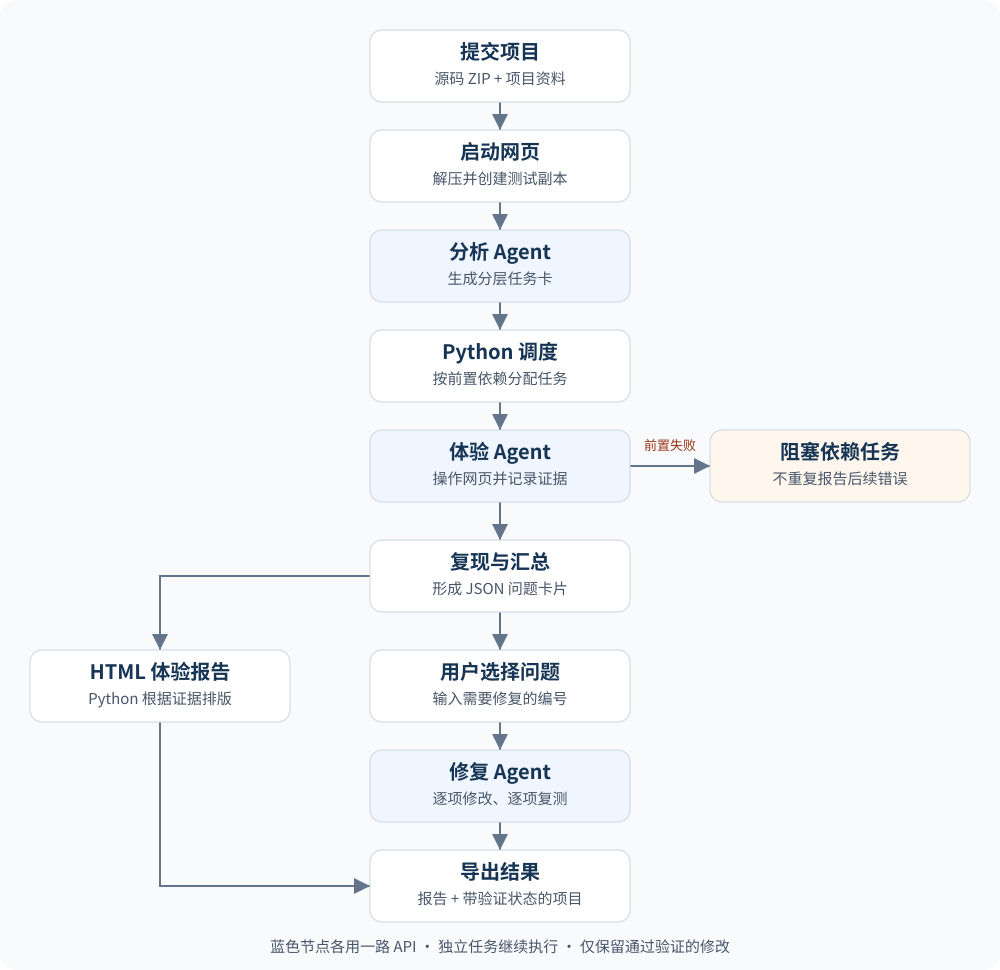

# DemoClinic

上传 Web Demo 源码 ZIP，让 Agent 在浏览器中检查功能、记录问题，并按你的选择生成修复候选。Python 负责复现、复测和导出结果，整个流程在本地 Jupyter 中运行。

[GitHub](https://github.com/vivilfollow925925-bit/DemoClinic)

## 工作流程



- **分析 Agent**：根据首页、项目根目录 README 和用户填写的要求，生成12张分层任务卡。目前不读取业务源码。
- **体验 Agent**：执行当前任务卡，点击、输入、检查页面结果，保存问题和证据。独立任务默认最多2个并发；前置任务未通过时，依赖任务暂停。
- **修复 Agent**：根据用户选择的问题读取源码，在副本中生成修改。每轮处理一个问题。
- **Python**：校验任务依赖、重放问题、生成 HTML 报告，并在第12步验证候选修改。

每张任务卡包含范围、前置条件、测试输入、操作步骤、预期结果和完成条件。体验规范包含42个候选检查维度，按项目和任务选用，不要求逐项检查。

体验任务使用独立的项目副本和浏览器。页面记忆提供简短参考，不会把上一任务的登录状态或业务数据直接传给下一任务。

## 快速开始

当前主要在 Windows、Python 3.13、JupyterLab 和 Chromium 环境下使用。

下载项目并解压，在项目目录打开终端：

```powershell
python -m venv .venv
.\.venv\Scripts\python.exe -m pip install -r requirements.txt
.\.venv\Scripts\python.exe -m playwright install chromium
.\.venv\Scripts\python.exe -m jupyterlab "DemoClinic主工作流.ipynb"
```

依赖安装完成后，也可以双击 `打开工作流.cmd`。

模型 API 需要自行开通并按服务商规则付费。待测项目若需要 Node.js、数据库等环境，也要另行准备。

## 怎么使用

按顺序运行 Notebook，不要直接点击“运行全部”：上传表单和问题选择需要等待你的输入。

| 步骤 | 要做的事 |
| --- | --- |
| 1–2 | 解包程序、准备浏览器。 |
| 3 | 配置分析、体验、修复三路模型。 |
| 4 | 上传项目 ZIP，填写项目资料，点击提交。 |
| 5–6 | 输入三路 API Key，检查接口连接。仅出报告时不需要修复 Key。 |
| 7 | 启动项目副本，查看首页截图。 |
| 8 | 生成并查看12张任务卡。 |
| 9 | 执行体验任务，保存检查结果。 |
| 10 | 独立复现问题，生成 HTML 报告和 JSON 问题单。只需要报告时，到这里即可。 |
| 11 | 选择一个问题编号，生成修复候选。 |
| 12 | 复测候选、本轮之前已修复的问题和已有正常流程。通过后才采用修改。 |
| 13 | 导出更新后的报告和项目 ZIP。 |
| 14 | 清除本次进程中的 API Key。 |

想继续修下一个问题，完成第12步后，再运行第11–13步。新一轮基于此前已验证的副本继续；失败候选不会覆盖此前成果。没有候选时，第12步跳过复测。

### 上传什么

上传包含源码、样式、图片等资源的 ZIP，并填写：

- 项目名称、用途和目标用户。
- 1–5项核心任务及各自的成功标准。
- 重点测试范围、已知问题和需要保留的设计约束。
- 测试账号与数据的准备情况，不填写真实密码。
- 选择仅出报告，或继续修复与复测。

纯 HTML/CSS/JavaScript 项目通常可自动启动。无法识别入口时，在高级设置填写启动命令、准备命令及端口。ZIP 最大50 MB，解压后最大200 MB、最多10,000个文件。

## 模型与运行设置

在第3步配置模型和接口地址，在第5步输入 Key。型号由代码配置决定，不由 Key 决定。

| 角色 | 默认模型 | 用途 |
| --- | --- | --- |
| 分析 | `glm-5.3` | 生成分层任务卡 |
| 体验 | `glm-5.3-flash` | 浏览器操作与问题记录 |
| 修复 | `glm-5.3` | 读取源码并生成修改 |

三路分别配置 `provider`、`base_url`、`model` 和 Key。默认地址为智谱标准接口；第三方平台的 Key 必须配套该平台的地址和模型 ID。开启 `vision` 时，体验模型需支持图片输入。第6步只检查文字连接。

当前运行代码按阶段共用30分钟时限，不主动设置模型输出 token 上限，也不按调用轮数停止。服务商自身仍可能限制输出。Notebook 中部分旧预算字段仅为兼容保留，不控制当前分层流程。

体验上下文保留近期交互和按需读取的检查规范；HTML 由 Python 根据证据生成，不额外调用模型写报告。运行日志保存到本轮 `agent_logs`，接口返回的用量按三类角色汇总到 `api_usage_summary.json`。超时或未返回完整用量的请求，实际费用以服务商账单为准。

## 结果怎么看

```text
DemoClinic运行目录/
├── implementation/       # 第1步从 Notebook 解包生成
└── outputs/
    └── <运行编号>/
        ├── 体验与修复报告.html
        ├── 修复问题单.json
        ├── task_plan.json
        ├── task_state.json
        ├── api_usage_summary.json
        └── 交付结果/      # 第12、13步整理的报告、项目 ZIP 和运行说明
```

HTML 面向阅读，图片已内嵌；JSON 保存结构化问题和证据。原始上传包、项目副本和各次运行记录也保存在本轮目录中。

| 状态 | 含义 |
| --- | --- |
| `pending_verification` | 已生成候选，等待第12步复测。 |
| `verified` | 所选修改通过本次问题检查和回归检查。 |
| `partial_verified` | 当前仍有待处理项，保留此前已验证的修改。 |
| `verification_blocked` | 测试操作受阻，尚不能判断修改是否有效。 |
| `not_verified` | 检查未全部通过。 |
| `skipped` | 本次没有执行修复或复测。 |

复测通过不代表整个项目没有缺陷。按钮或选项的 ID 改变时，程序会依据已记录的身份和备用定位寻找目标；缺少证据或匹配有歧义时停止，不猜测目标、不降低预期。

## 项目文件

- `DemoClinic主工作流.ipynb`：运行入口，内嵌程序和 Agent 规范。
- `打开工作流.cmd`、`requirements.txt`：启动入口和依赖清单。
- `项目说明.md`：项目背景、用途和当前进展。
- `docs/`：流程图。
- `实验样本/`：四个测试项目及独立评估材料。评估材料不应作为体验 Agent 的输入。
- `DemoClinic运行目录/`：解包程序和运行结果。

第1步会重新生成 `implementation`，不会清空 `outputs`。修改运行代码时，需要同时更新 Notebook 的内嵌包，否则重新解包会恢复包中的版本。

## 使用范围

当前主要面向功能目标明确、能在本机启动的 Web Demo。它检查功能是否符合约定，不代替产品定位、视觉设计或完整的软件测试。

任务规划、覆盖范围和修复效果受模型能力、时间与输入要求影响。未检查到的问题可能仍然存在；前置问题修好后，被阻塞的任务不会自动恢复，需要重新体验。

工作流在本地执行项目，相关页面内容、截图和修复所需源码会发送给配置的模型 API。请使用获准测试的项目和测试数据；项目副本不提供安全沙箱隔离。不要上传密钥或连接生产数据。
